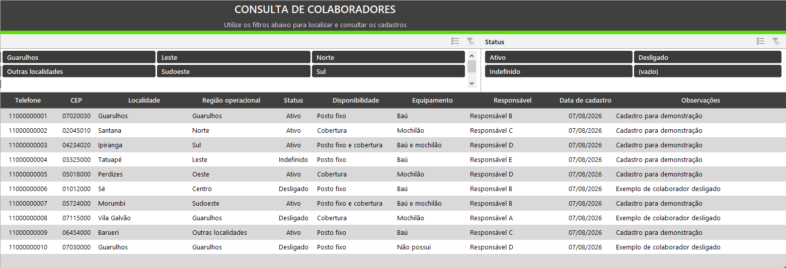
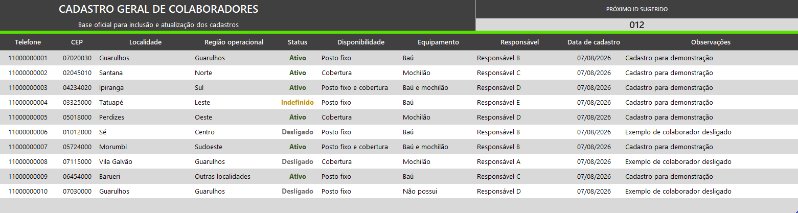

# Banco de Colaboradores

Solução empresarial desenvolvida para centralização, organização e consulta de cadastros de colaboradores.

## Contexto empresarial

Desenvolvido em ambiente profissional para atender demandas reais de gestão administrativa de uma empresa do setor de logística.

A solução foi desenvolvida para aplicação na rotina empresarial, facilitando a organização das informações cadastrais e a identificação de pendências.

## Objetivo

Centralizar informações de colaboradores em uma base padronizada, facilitar consultas e identificar pendências cadastrais, reduzindo a necessidade de manter diferentes fontes de informação.

## Estrutura da solução

| Camada | Responsabilidade |
| --- | --- |
| Início | Orientações de utilização |
| Cadastro geral | Fonte central de registros |
| Consulta | Visualização e filtros |
| Pendências | Conferência de informações cadastrais |
| Apoio técnico | Estruturas auxiliares |

## Funcionalidades

- Centralização dos registros de colaboradores.
- Padronização dos estados Ativo, Desligado e Indefinido.
- Consultas automatizadas com Power Query.
- Filtros interativos por segmentação de dados.
- Identificação de pendências cadastrais.
- Validação de dados.
- Separação entre cadastro, consulta e estruturas técnicas.

## Tecnologias utilizadas

- Microsoft Excel 2019
- Power Query (linguagem M)
- Validação de dados
- Segmentação de dados

## Resultados e competências

- Centralização e padronização das informações cadastrais.
- Facilidade na consulta de registros.
- Identificação de inconsistências e pendências.
- Modelagem e qualidade de dados.
- Desenvolvimento de ferramentas de gestão administrativa.

## Demonstração

### Consulta de colaboradores

### Cadastro geral

A versão demonstrativa está disponível neste diretório:

[Banco de Colaboradores — Excel](BANCO%20DE%20COLABORADORES%20-%20PORTFOLIO.xlsx)

O arquivo permite explorar as funcionalidades da solução utilizando registros fictícios.

## Confidencialidade

Este repositório apresenta uma versão demonstrativa de uma solução desenvolvida em ambiente empresarial.

Os registros disponibilizados são fictícios. Dados pessoais reais, cadastros corporativos e arquivos originais não fazem parte deste material.
