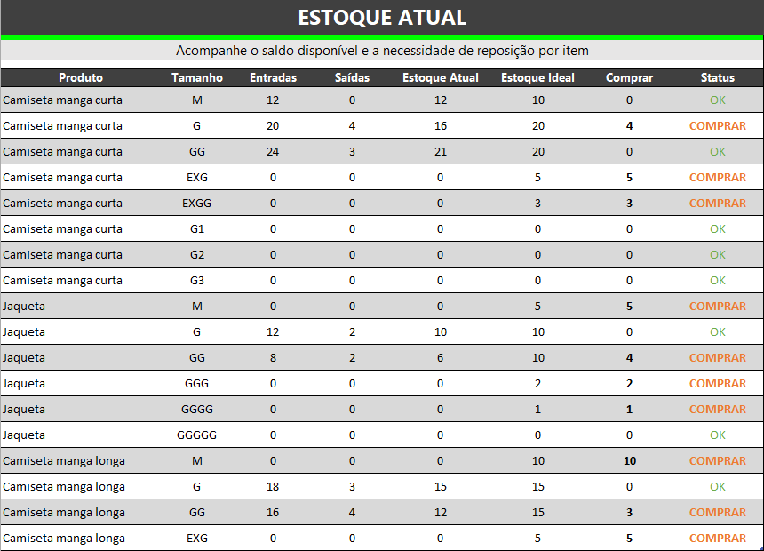
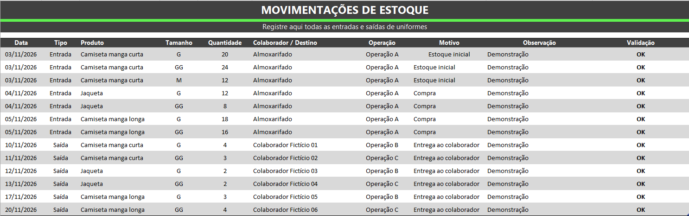

# Controle de Estoque de Uniformes

Solução empresarial desenvolvida para controle de estoque de uniformes, com rastreabilidade de movimentações e acompanhamento da necessidade de reposição.

## Contexto empresarial

Desenvolvido em ambiente profissional para atender demandas reais de gestão de estoque de uma empresa do setor de logística.

A solução foi desenvolvida para auxiliar a rotina administrativa no acompanhamento da disponibilidade de uniformes e no planejamento de reposições.

## Objetivo

Controlar o estoque de uniformes por produto e tamanho, garantindo que os saldos sejam calculados a partir do histórico de movimentações, sem depender de atualizações manuais de quantidades.

## Estrutura da solução

O estoque atual é calculado a partir das entradas e saídas registradas, preservando o histórico das movimentações.

## Funcionalidades

- Registro de entradas e saídas de uniformes.
- Controle de estoque por produto e tamanho.
- Consolidação automática das movimentações.
- Cálculo do estoque disponível.
- Comparação entre estoque atual e estoque ideal.
- Indicadores de necessidade de reposição.
- Consulta ao histórico de movimentações.
- Identificação de registros com histórico incompleto.

## Tecnologias utilizadas

- Microsoft Excel 2019
- Power Query (linguagem M)
- Fórmulas e funções do Excel
- Validação de dados

## Resultados e competências

- Centralização do controle de estoque.
- Rastreabilidade das movimentações.
- Redução da necessidade de ajustes manuais de saldo.
- Apoio ao planejamento de reposições.
- Modelagem de dados e regras de negócio.
- Consolidação e transformação de dados operacionais.

## Demonstração

### Estoque atual

### Movimentações

A versão demonstrativa está disponível neste diretório:

[Controle de Estoque — Excel](CONTROLE%20DE%20ESTOQUE%20-%20PORTFOLIO.xlsx)

O arquivo permite explorar as funcionalidades da solução utilizando movimentações e quantidades fictícias.

## Confidencialidade

Este repositório apresenta uma versão demonstrativa de uma solução desenvolvida em ambiente empresarial.

As movimentações e quantidades disponibilizadas são fictícias. Dados operacionais reais, informações corporativas e arquivos originais não fazem parte deste material.
