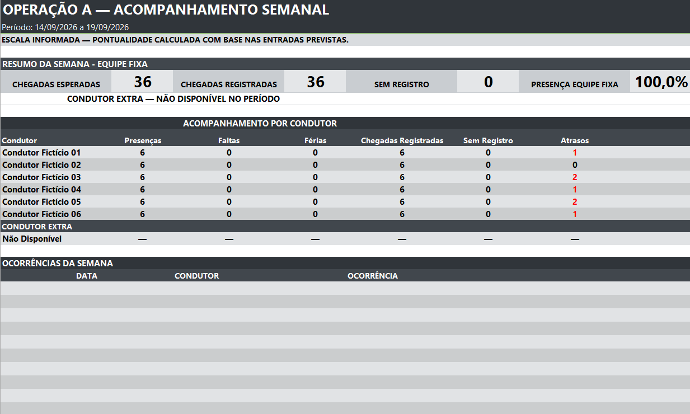
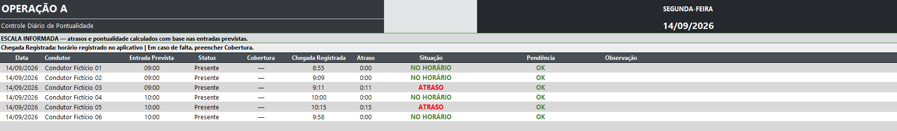

# Controle de Pontualidade

*Projeto empresarial · Concluído*

Solução empresarial desenvolvida para acompanhamento de presença, pontualidade, atrasos e coberturas de escala.

## Contexto empresarial

Desenvolvido em ambiente profissional para atender demandas reais de acompanhamento de condutores de uma empresa do setor de logística.

A solução foi desenvolvida para auxiliar a rotina operacional, padronizando os registros diários e consolidando as informações em indicadores semanais.

## Objetivo

Centralizar o controle de horários, presenças e ocorrências operacionais, facilitando a identificação de atrasos e o acompanhamento das escalas.

## Estrutura da solução

| Camada | Responsabilidade |
| --- | --- |
| Abas diárias | Registro das ocorrências de segunda a sábado |
| Validações | Padronização das informações registradas |
| Relatório semanal | Consolidação dos registros |
| Dashboard | Visualização dos indicadores |

## Funcionalidades

- Controle de presença e faltas.
- Registro de horários previstos e realizados.
- Cálculo automático de atrasos.
- Controle de coberturas de escala.
- Validação dos registros diários.
- Consolidação automática das informações semanais.
- Dashboard de acompanhamento operacional.
- Preservação do histórico das semanas anteriores.

## Regra de negócio

O modelo utiliza uma tolerância demonstrativa de 10 minutos.

Quando o limite é ultrapassado, contabiliza-se o atraso integral desde o horário previsto.

Exemplo considerando entrada às 09h00:

| Chegada | Atraso contabilizado |
| --- | ---: |
| 09h09 | 0 min |
| 09h10 | 0 min |
| 09h11 | 11 min |
| 09h25 | 25 min |

## Tecnologias utilizadas

- Microsoft Excel 2019
- Fórmulas e funções do Excel
- Validação de dados
- Dashboard e indicadores

## Resultados e competências

- Padronização dos registros operacionais.
- Consolidação de informações periódicas.
- Automação de cálculos de pontualidade.
- Apoio ao acompanhamento de escalas.
- Implementação de regras de negócio.
- Construção de indicadores de desempenho.

## Demonstração

### Dashboard semanal

### Registro diário

A versão demonstrativa está disponível neste diretório:

[Controle de Pontualidade — Excel](CONTROLE%20DE%20PONTUALIDADE%20-%20PORTFOLIO.xlsx)

O arquivo permite explorar as funcionalidades da solução utilizando condutores, horários e ocorrências fictícias.

## Confidencialidade

Este repositório apresenta uma versão demonstrativa de uma solução desenvolvida em ambiente empresarial.

Os registros disponibilizados são fictícios. Nomes de condutores, escalas reais, informações operacionais e arquivos corporativos originais não fazem parte deste material.
