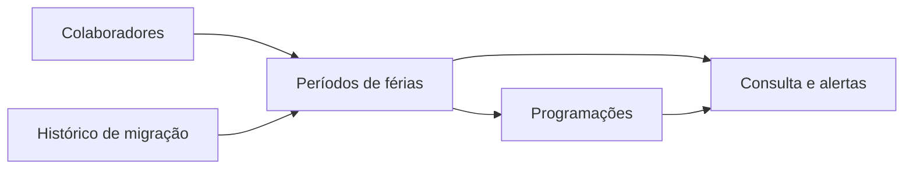
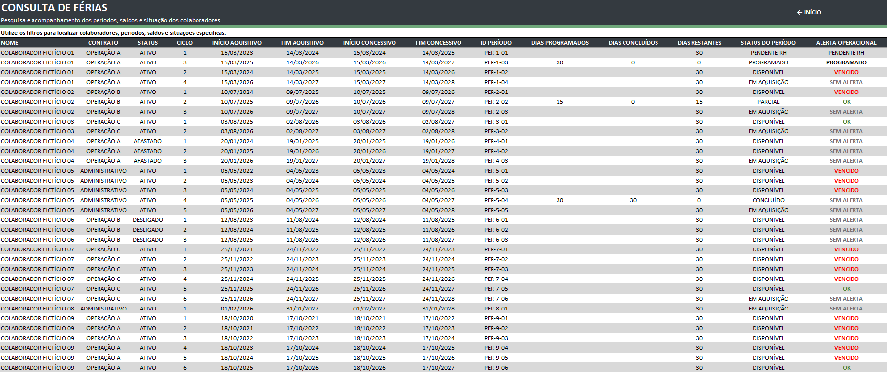
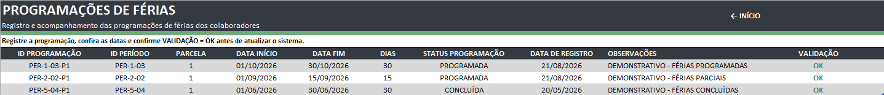

# Gestão de Férias

Solução empresarial desenvolvida para acompanhamento de períodos de férias, programações, saldos, prazos e pendências de Recursos Humanos.

## Contexto empresarial

Desenvolvido em ambiente profissional para atender demandas reais de gestão de pessoas de uma empresa do setor de logística.

A solução foi desenvolvida para auxiliar a rotina do RH, centralizando informações relacionadas aos períodos de férias e facilitando o acompanhamento das programações.

## Objetivo

Organizar e acompanhar os períodos de férias dos colaboradores, permitindo a identificação de saldos, prazos e pendências, sem comprometer o histórico das informações anteriores.

## Estrutura da solução

A planilha separa os cadastros, períodos de férias, programações, consultas e estruturas técnicas de apoio.

## Funcionalidades

- Cadastro e acompanhamento de colaboradores.
- Controle de períodos de férias.
- Registro e acompanhamento de programações.
- Consulta de saldos disponíveis.
- Monitoramento de prazos e alertas.
- Classificação dos períodos por situação.
- Identificação de pendências para conferência pelo RH.
- Preservação do histórico de dados migrados.
- Separação entre operação e estruturas técnicas.

## Tecnologias utilizadas

- Microsoft Excel 2019
- Power Query (linguagem M)
- Fórmulas e funções do Excel
- Validação de dados

## Resultados e competências

- Centralização das informações de férias.
- Organização do histórico de períodos e programações.
- Apoio ao planejamento das atividades do RH.
- Modelagem de estados e regras temporais.
- Migração e tratamento de dados.
- Separação de responsabilidades e qualidade da informação.

## Demonstração

### Consulta de férias

### Programações

A versão demonstrativa está disponível neste diretório:

[Gestão de Férias — Excel](GESTÃO%20DE%20FÉRIAS%20-%20PORTFOLIO.xlsx)

O arquivo permite explorar as funcionalidades da solução utilizando colaboradores, períodos e programações fictícias.

## Confidencialidade

Este repositório apresenta uma versão demonstrativa de uma solução desenvolvida em ambiente empresarial.

Os registros disponibilizados são fictícios. Dados pessoais, informações trabalhistas reais e arquivos corporativos originais não fazem parte deste material.
